<p align="center">
  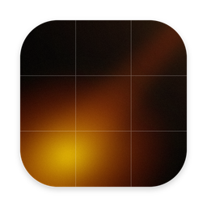
</p>

<h1 align="center">Briefing</h1>

<p align="center">
  <b>Open your Mac in the morning. Your whole day is already on the screen.</b>
</p>

<p align="center">
  <a href="https://github.com/Vanodium/Briefing/releases/latest">
    <picture>
      <source media="(prefers-color-scheme: dark)" srcset="assets/readme/download-dark.png">
      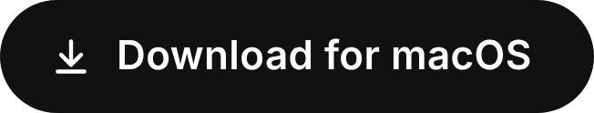
    </picture>
  </a>
</p>

<p align="center">
  <sub>Free&nbsp;&nbsp;·&nbsp;&nbsp;macOS 14+&nbsp;&nbsp;·&nbsp;&nbsp;Apple silicon & Intel&nbsp;&nbsp;·&nbsp;&nbsp;No account, no tracking</sub>
</p>

<p align="center">
  <a href="#how-it-works">How it works</a>&nbsp;&nbsp;·&nbsp;&nbsp;
  <a href="#ten-kinds-of-morning-light">Themes</a>&nbsp;&nbsp;·&nbsp;&nbsp;
  <a href="#install">Install</a>&nbsp;&nbsp;·&nbsp;&nbsp;
  <a href="#privacy">Privacy</a>&nbsp;&nbsp;·&nbsp;&nbsp;
  <a href="#faq">FAQ</a>
</p>

<br>

<picture>
  <source media="(prefers-color-scheme: dark)" srcset="assets/readme/hero-dark.webp">
  
</picture>

<br>

## Everything that matters. Nothing else.

<table>
  <tr>
    <td width="33%" valign="top">
      <picture>
        <source media="(prefers-color-scheme: dark)" srcset="assets/readme/card-principles-dark.webp">
        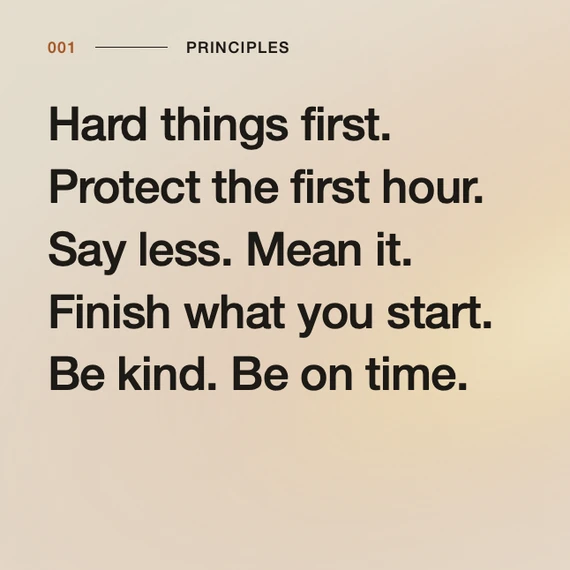
      </picture>
      <br><b>Your principles</b>
      <br>The few rules you live by. Read them before anything else.
    </td>
    <td width="33%" valign="top">
      <picture>
        <source media="(prefers-color-scheme: dark)" srcset="assets/readme/card-today-dark.webp">
        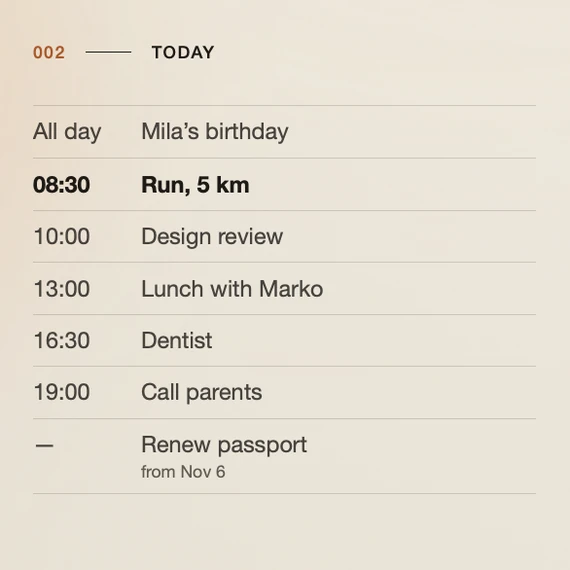
      </picture>
      <br><b>Today</b>
      <br>Calendar, Reminders, Google Calendar. What's next is in bold.
    </td>
    <td width="33%" valign="top">
      <picture>
        <source media="(prefers-color-scheme: dark)" srcset="assets/readme/card-month-dark.webp">
        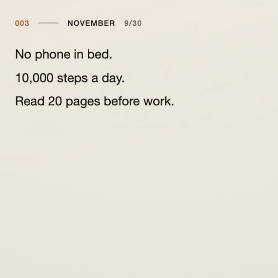
      </picture>
      <br><b>This month</b>
      <br>One challenge for 30 days. You see it every single morning.
    </td>
  </tr>
</table>

Plus the time, the date and the weather. No feeds, no news, no notifications.

## How it works

**1. Wake your Mac.** Briefing opens by itself — once a day, the first time you wake your Mac after a chosen time. Already at your desk by then? It opens right on time.

**2. Read.** The weekday and the time come first, then the day opens: your principles, today's plan, this month's challenge.

**3. Press Enter.** It fades away. Go.

The app lives in the menu bar and stays out of your way the rest of the day.

## Ten kinds of morning light

<picture>
  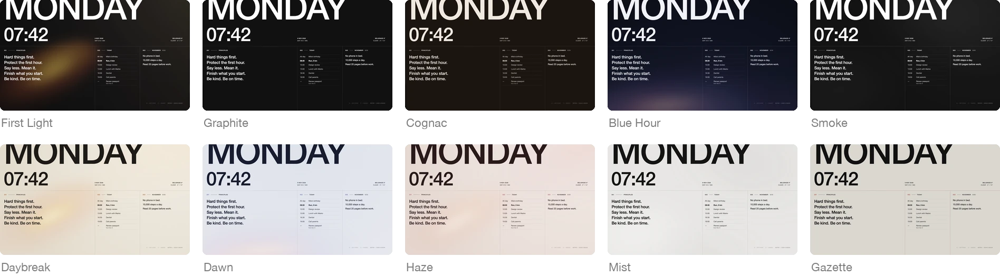
</picture>

<details>
<summary><b>See each one up close</b></summary>
<br>

**First Light** — Low morning sun through a window. The signature.
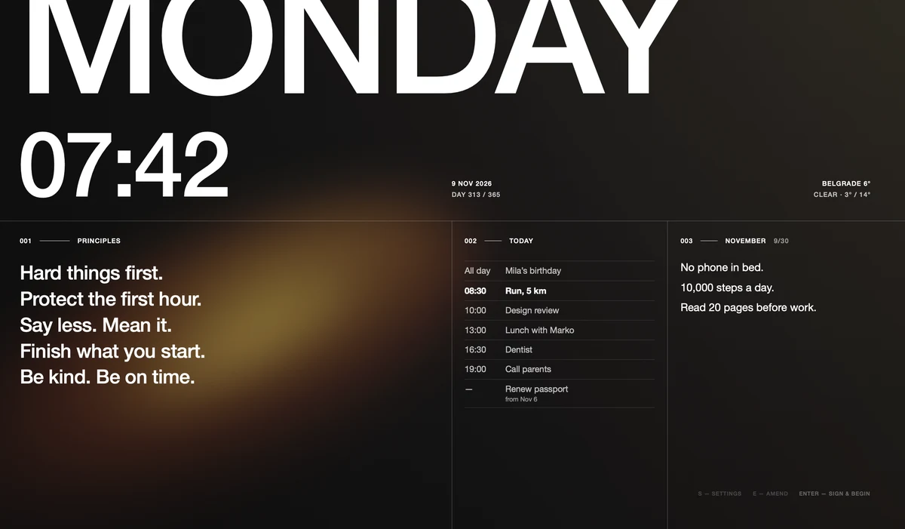

**Graphite** — Flat graphite. Nothing but the type.
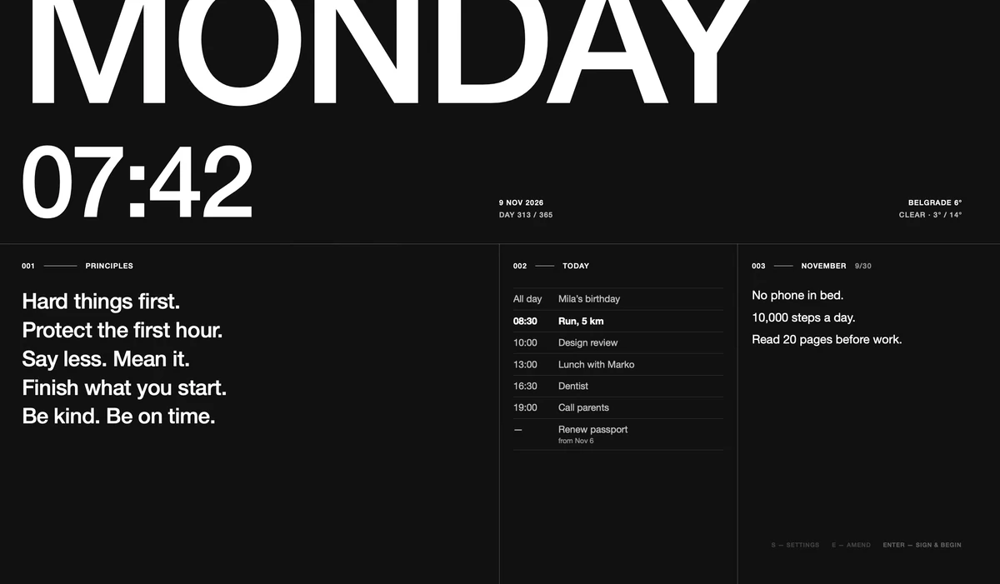

**Cognac** — Dark leather, warm bone type.
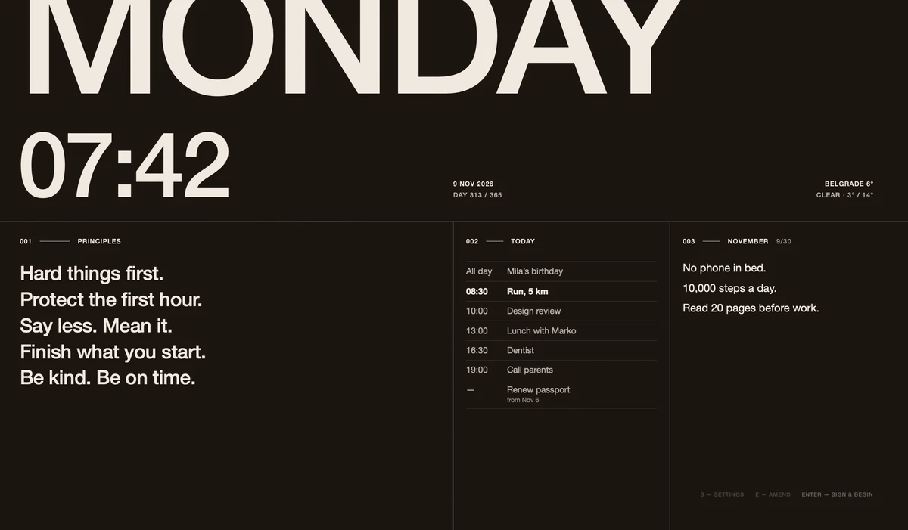

**Blue Hour** — Before first light: deep blue, a glow under the horizon.
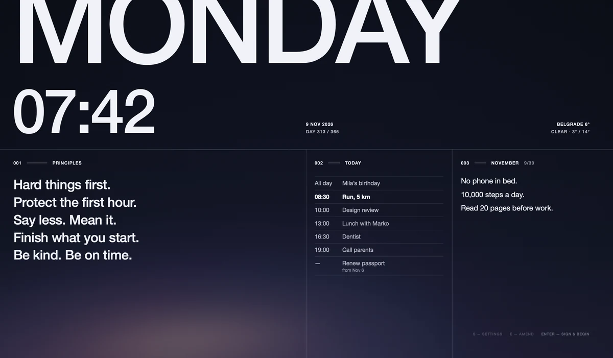

**Smoke** — A slow drift of smoke. Only light and air.
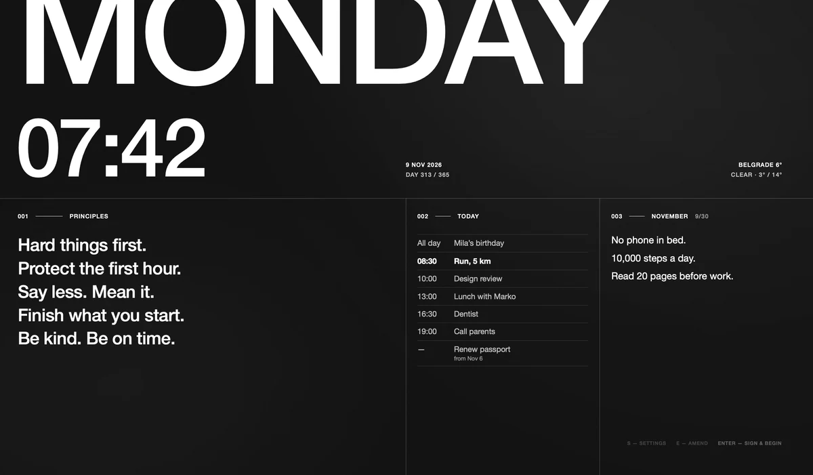

**Daybreak** — First Light on paper: warm sun across a cream page.
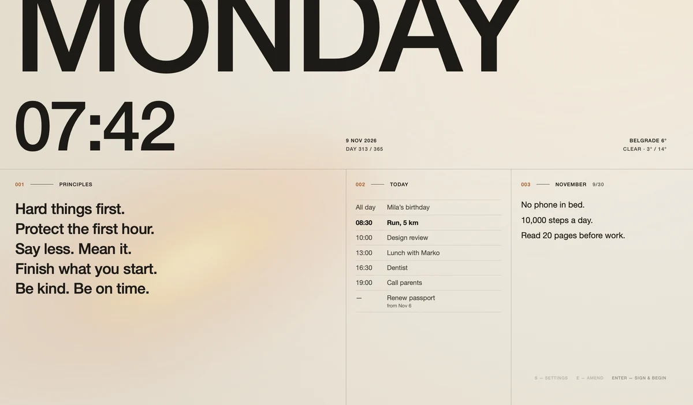

**Dawn** — A pale sky, peach and lilac over the horizon.
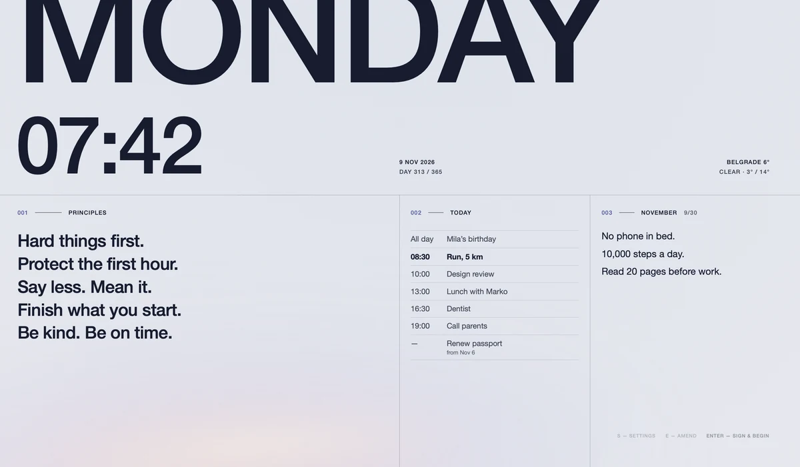

**Haze** — A rose morning haze settling into peach light.
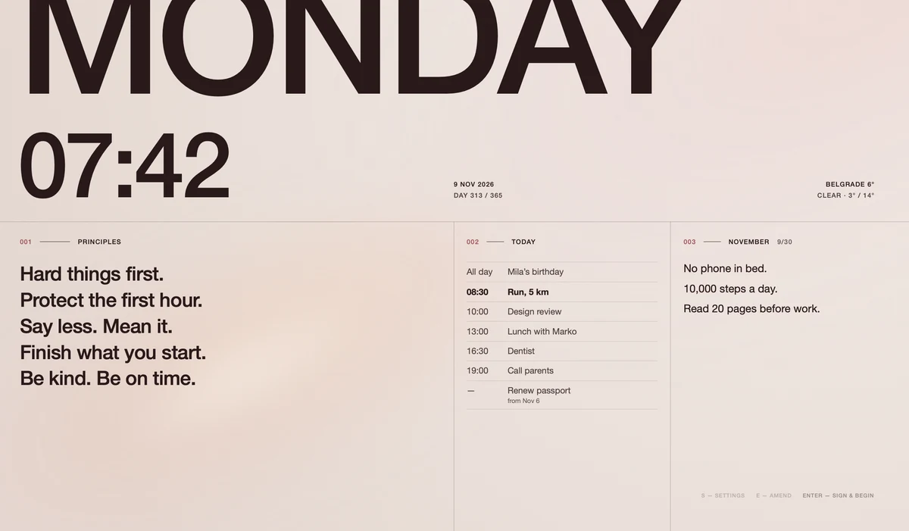

**Mist** — Pale grey air, slow shadows drifting through it.
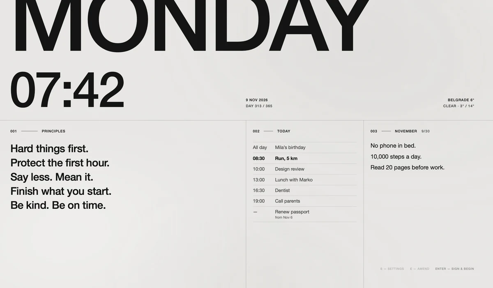

**Gazette** — The morning paper. Black type, one red rule.
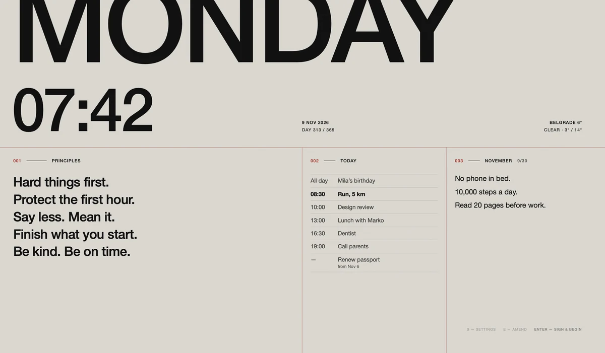

</details>

## Install

**1.** [Download the latest `.dmg`](https://github.com/Vanodium/Briefing/releases/latest) and drag Briefing into Applications.

**2.** Open it. macOS will block it the first time — that's expected. Allow it once:

<details>
<summary><b>macOS 15 Sequoia or later</b></summary>
<br>

1. Open Briefing. When macOS says it can't verify the app, click **Done**.
2. Go to **System Settings → Privacy & Security** and scroll down.
3. Next to "Briefing was blocked", click **Open Anyway**.

</details>

<details>
<summary><b>macOS 14 Sonoma</b></summary>
<br>

Control-click Briefing in Applications → **Open** → **Open**.

</details>

<details>
<summary><b>Or one line in Terminal</b></summary>
<br>

```bash
xattr -dr com.apple.quarantine /Applications/Briefing.app
```

</details>

<details>
<summary>Why is it blocked?</summary>
<br>

Apple charges a yearly fee to "notarize" apps, and Briefing is a free side project. The code is all here — read it, or [build it yourself](#for-developers) and skip this step entirely.

</details>

**3.** A one-minute setup: theme, your calendars (Apple or Google) and city, your principles, this month's challenge, wake time. Done — see you tomorrow morning.

## Privacy

**Your day never leaves your Mac.** No account. No analytics. No servers.

<details>
<summary>What does it connect to, exactly?</summary>
<br>

- **Open-Meteo** — your city's coordinates, for the weather.
- **Apple** — the city name you type, once, to find it on the map.
- **GitHub** — to check for updates, only if you allow it.
- **Google** — your calendars, only if you connect an account.

Calendar events, reminders, principles and challenges are read and stored only on your Mac.

</details>

## FAQ

<details>
<summary><b>Will it pop up every time I open my laptop?</b></summary>
<br>

No. Once a day — the first time you wake, unlock or log in after your chosen time, or at that time if the Mac is already awake. Missed it? Press <kbd>⌃</kbd><kbd>⌥</kbd><kbd>⌘</kbd><kbd>M</kbd> anywhere to bring it back.

</details>

<details>
<summary><b>Does it work with Google or Outlook calendar?</b></summary>
<br>

Google — yes. **Settings → Calendars → Connect Google Account…** — sign in in your browser and the events appear on the dashboard. Access is read-only; the sign-in stays in your Keychain, and the day's events are kept on your Mac so the morning screen never waits for the network.

Outlook — add the account in System Settings → Internet Accounts, and its calendars show up under Apple Calendar. The same works for Google; connected both ways, each event still shows once.

</details>

<details>
<summary><b>How do I change my principles or challenge?</b></summary>
<br>

Press <kbd>E</kbd> on the dashboard. Everything turns into text you can edit. Saved as you type. On the last day of the month, you can set next month's challenge in advance.

</details>

<details>
<summary><b>Keyboard shortcuts?</b></summary>
<br>

| Key | Does |
|---|---|
| <kbd>Enter</kbd> or <kbd>Space</kbd> | close · open the day right away, without waiting |
| <kbd>Esc</kbd> | close · stop editing |
| <kbd>E</kbd> | edit principles and challenges |
| <kbd>S</kbd> | settings |
| <kbd>⌃</kbd><kbd>⌥</kbd><kbd>⌘</kbd><kbd>M</kbd> | show or hide Briefing from anywhere |

All of them can be changed in **Settings → Shortcuts**.

</details>

<details>
<summary><b>What can I customize?</b></summary>
<br>

The time it appears, the theme, the weather city, which blocks are shown and in what order, which calendars and reminder lists appear (Google ones too), whether other displays dim, and every shortcut. Menu bar icon → **Settings…**, or press <kbd>S</kbd>.

</details>

<details>
<summary><b>I have more than one display.</b></summary>
<br>

Briefing fills one screen and dims the rest. You can turn the dimming off in Settings.

</details>

<details>
<summary><b>It didn't open this morning.</b></summary>
<br>

Menu bar icon → **Open Log**. Lines starting with `waiting:` tell you what it was waiting for. **Reset "Shown Today"** in the same menu lets you try again.

No calendar? **Settings → Calendars → Allow Access**, or System Settings → Privacy & Security → Calendars.

No Google events? **Settings → Calendars** shows when they were last updated. If it says access has expired, disconnect and connect the account again.

</details>

<details>
<summary><b>Where is my data?</b></summary>
<br>

Plain JSON files you can edit by hand. Menu bar icon → **Open Data Folder**.

```
~/Library/Application Support/Briefing/
  mindset.json            your principles
  challenges.json         challenges by month
  challenges-archive.md   past months
  settings.json           everything in Settings
```

</details>

<details>
<summary><b>How does it update?</b></summary>
<br>

It checks this repository for new versions through [Sparkle](https://sparkle-project.org), if you allow it. Every update is signed; anything unsigned is refused.

</details>

<details>
<summary><b>What's the typeface?</b></summary>
<br>

Helvetica Neue, which every Mac has. If you own **Neue Haas Grotesk Display**, Briefing uses it instead — install it normally, or drop the `.otf` files into `~/Library/Application Support/Briefing/Fonts/`.

</details>

<details>
<summary><b>How do I uninstall it?</b></summary>
<br>

If you connected Google, click **Disconnect** in Settings → Calendars first. Then quit it from the menu bar, remove it from **System Settings → General → Login Items**, move it to the Trash. Your data stays in `~/Library/Application Support/Briefing/` — delete that folder too if you want it gone.

</details>

## Like it?

Briefing is free. If it makes your mornings better, you can buy me a coffee.

<a href="https://ko-fi.com/vanodium"></a>

<br>

## For developers

<details>
<summary><b>Build from source</b></summary>
<br>

Needs macOS 14 and Swift (Xcode, or just `xcode-select --install`).

```bash
git clone https://github.com/Vanodium/Briefing.git
cd Briefing
./install.sh      # build, install into ~/Applications, launch
./uninstall.sh    # remove the app and its login item; your data stays
```

`./build.sh` alone builds `build/Briefing.app`. The first build downloads Sparkle and takes a few minutes. A copy you build yourself never hits the "can't verify" warning.

</details>

<details>
<summary><b>Google sign-in</b></summary>
<br>

Direct sign-in needs an OAuth client of your own. Without one the app builds and runs, and Settings says sign-in is not set up in this build.

1. [Create a project](https://console.cloud.google.com/projectcreate) and [enable the Google Calendar API](https://console.cloud.google.com/apis/library/calendar-json.googleapis.com).
2. [Google Auth Platform](https://console.cloud.google.com/auth/overview): audience *External*, data access `.../auth/calendar.readonly`.
3. On [Audience](https://console.cloud.google.com/auth/audience), click **Publish app**. While it is in *Testing*, Google ends every sign-in after 7 days. Until Google verifies the app, sign-in shows an "unverified app" warning (**Advanced → Go to Briefing**).
4. [Create an OAuth client](https://console.cloud.google.com/auth/clients/create) of type *Desktop app*.

Put the ID and secret into `oauth.env` next to `build.sh` (it is git-ignored) or into the environment:

```bash
GOOGLE_CLIENT_ID=….apps.googleusercontent.com
GOOGLE_CLIENT_SECRET=…
```

`build.sh` writes them into the app's Info.plist — `release.sh` too, so keep `oauth.env` on the Mac you release from.

</details>

<details>
<summary><b>Release a new version</b></summary>
<br>

Once per Mac, `tools/setup-signing.sh` creates the release certificate and Sparkle's update key and backs them up to `~/Documents/Briefing-signing/`. Keep that backup safe: every future version must be signed with the same keys, or installed copies lose Calendar access and stop updating.

```bash
./release.sh 1.0.1    # → dist/Briefing-1.0.1.dmg, the update archive and appcast.xml
```

Commit the version bump and attach the three files to a GitHub release tagged `v1.0.1` — the script prints the command.

</details>

<details>
<summary><b>Logs and state</b></summary>
<br>

- Log: `~/Library/Logs/Briefing.log` — every open/skip decision is written there.
- `state.json` — when it was last shown. `weather-cache.json` — the last weather, for offline mornings. `google-cache.json` — the day's events from a connected Google account.
- Wake detection: wake, unlock, login and screensaver end trigger a check; a 30-second timer catches sleeps macOS forgot to announce.

</details>

<br>

<p align="center">
  <sub>
    Weather by <a href="https://open-meteo.com/">Open-Meteo</a> (CC BY 4.0) · Updates by <a href="https://sparkle-project.org">Sparkle</a> · <a href="LICENSE">MIT</a> © 2026 Vanodium
  </sub>
</p>
